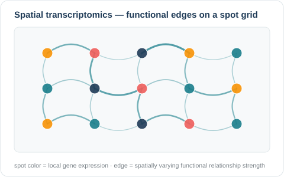
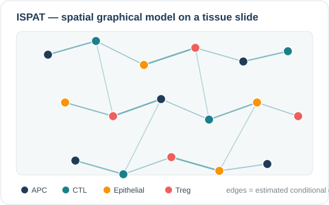
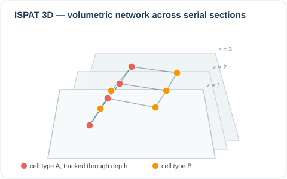
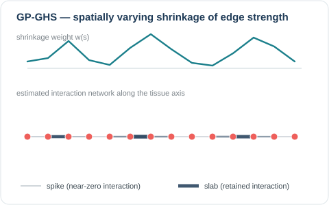
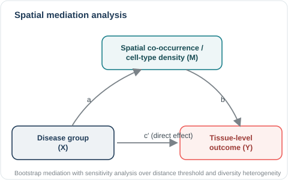
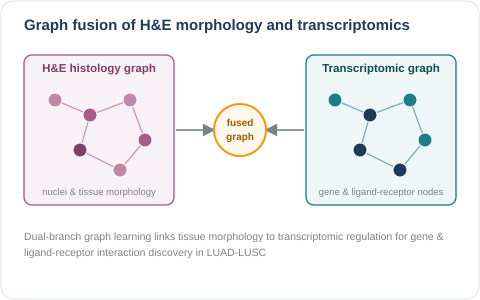
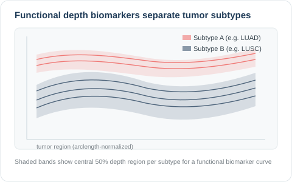
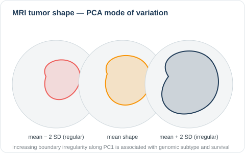
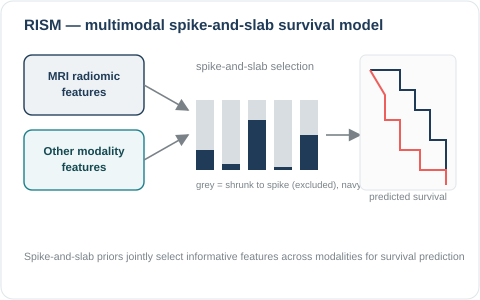

Each method below was developed for a particular data type, and the projects are grouped by the data they analyze. The [Research]({{ "/research/" | relative_url }}) page groups the same work by methodological direction. Code and data for each project are released with the corresponding preprint or publication (see [Publications]({{ "/publications/" | relative_url }}) for full citations).

---

## Spatial Transcriptomics

Spatial transcriptomics records gene expression together with the tissue coordinates of each measurement, so expression can be studied jointly with tissue architecture. I use these data to model gene–gene and ligand–receptor interactions, to analyze spot-level cell-type proportions as spatial compositional data, and to link tissue morphology to gene expression measured on the same section.

{: .align-center}

* Tsang, A., Krishnan, S., Kulkarni, R., Bhadury, S., Rao, A., et al. [Encoding functional edges in graphs to model spatially varying relationships in the tumor microenvironment](https://doi.org/10.1038/s44387-026-00075-5), **npj Artificial Intelligence**.
* Bhadury, S., Schwob, M., Datta, J. Spatial Active-Set Ray Regression for Compositional Data: Methodology, Validation, and Applications in Spatial Transcriptomics and Community Ecology. Regression for spot-level cell-type proportions that respects the sum-to-one constraint, handles zeros directly, and accounts for spatial dependence. (In preparation)
* Bhadury, S., Rao, A. SHIRE: Spatial Horseshoe Image-Basis Regression for Morphology and Gene Expression Associations in Spatial Transcriptomics. Horseshoe-shrunk regression that links H&amp;E morphology to single-cell gene expression. (In preparation)

## 2D & 3D Multiplexed Immunofluorescence (mIF)

Multiplexed immunofluorescence records the spatial coordinates and marker intensities of many cell types on a single tissue section (2D) or across registered serial sections (3D). With these data I build spatial graphical models of the cell–cell interaction networks in the tumor microenvironment, test whether the interaction patterns differ by disease state, and separate spatial organization from differences in tissue composition.

{: .align-center}

* Bhadury, S. et al. [ISPat: Informed Spatially Aware Patterns for Multiplexed Immunofluorescence data](https://www.nature.com/articles/s41598-026-35341-8), **Nature Scientific Reports**. Bayesian spatial modeling of cell-type intensities that recovers a shared interaction network and one network per tumor-density region. [Code](https://github.com/sagnikbhadury/ISPAT)

{: .align-center}

* Bhadury, S., Rao, A. [Estimating conditional cell population associations across tumor density trajectory in three dimensional tissue images (ISPat 3D)](https://www.nature.com/articles/s41598-026-73151-0), **Nature Scientific Reports**. Extends spatial network estimation to volumetric, 3D multiplexed cancer imaging. [Code](https://github.com/sagnikbhadury/ISPAT-3D) | [R package on CRAN](https://cran.r-project.org/web/packages/ISPAT3D/)

{: .align-center}

* Bhadury, S., Gaskins, J., Rao, A. [Spatially Varying Graphical Models for Cell-Cell Interaction Networks in Multiplexed Tissue Imaging](https://doi.org/10.64898/2026.04.01.715977). Group horseshoe shrinkage priors combined with Gaussian-process spatial structure (GP-GHS) for interaction network estimation. [Code](https://github.com/sagnikbhadury/GP-GHS)

{: .align-center}

* Bhadury, S., Frankel, T.L., Rao, A. [Cellular Proximity and Conditional Coordination in the Colorectal and Pancreatic Tumor Microenvironment: A Patient-Level Analysis of Multiplexed Imaging](https://doi.org/10.64898/2026.10.08.757632)
* Bhadury, S., Frankel, T., Rao, A. Resolving Compositional Confounding in Spatial Proximity Analysis through Mediation in Tumor Microenvironments (in preparation)
* Bhadury, S., Frankel, T., Rao, A. Causal Mediation Decomposes Pancreatic Cancer Spatial Diversity into Compositional and Organizational Pathways (in preparation)
* Mediation and sensitivity analyses that test whether cell-type density and spatial co-occurrence patterns mediate the relationship between disease group and tissue-level outcomes. [Code](https://github.com/sagnikbhadury/Causal-Inference)

## H&E Imaging & Computational Pathology

Hematoxylin and eosin (H&amp;E) whole-slide images record tissue and cellular morphology. I use them to extract histomorphological features, to relate those features to molecular and spatial data, and to measure the molecular information carried by the embeddings of pathology foundation models.

<!--

{: .align-center}
-->

* Bhadury, S., Tsang, A., Ray, D., Lagisetty, K., Kundu, S., Rao, A. Graph-on-Vector Association Modeling of Histopathological and Transcriptomic Features in Lung Adenocarcinoma, **npj Artificial Intelligence** (accepted). Graph-on-vector regression of pathway, kinase and transcription-factor activities on participant-specific histomorphological phenotype graphs in TCGA-LUAD, with node-level Bayesian variable selection.
* Bhadury, S., Kulkarni, R., Rao, A. Quantifying Biological Signal in Pathology Foundation Models through Bayesian Mutual Information Estimation. Compares pathology foundation models by the molecular information their tile embeddings carry, against permutation nulls. (In preparation)

{: .align-center}

* Bhadury, S., Tsang, A.P., Ray, D., Lagisetty, K., Rao, A. [Functional Depth Biomarkers Distinguish Lung Squamous Cell Carcinoma from Lung Adenocarcinoma](https://doi.org/10.21203/rs.3.rs-9347794/v1) [Code](https://github.com/sagnikbhadury/Functional-Depth)

## Magnetic Resonance Imaging (MRI)

MRI provides tumor shape and radiomic features that characterize tumor phenotype without a biopsy. I combine these features with other modalities in multimodal survival models.

{: .align-center}

* Statistical shape analysis (PCA-based) of MRI-derived tumor contours in lower-grade glioma. [Code](https://github.com/sagnikbhadury/Shape-Analysis-of-LGG)

{: .align-center}

* Bhadury, S., Mohammed, S., Kurtek, S., Rao, A. RISM: Radiomic Feature Integration with Spike-and-Slab for Multimodal Survival Analysis. Spike-and-slab variable selection for integrating MRI-derived radiomic features with other modalities in survival models. (In preparation)

## Multivariate Spatial Data

Spatial studies often measure several outcomes over the same region at different locations. I build multivariate Gaussian-process models that borrow strength across such misaligned outcomes. Shrinkage priors let the data decide how much borrowing the design supports, and meshed Gaussian processes keep the models tractable for hundreds of thousands of observations.

* Bhadury, S. Design-Adaptive Borrowing Across Misaligned Outcomes in Bayesian Coregionalization Models [Code](https://github.com/sagnikbhadury/meshedghs)

## Language-Model Representations

The data are internal activations of large language models and the sparse-autoencoder dictionaries trained on them. I treat interpretability and compression as high-dimensional selection problems: which features carry a behavior, whether a learned feature is used by the model, whether two dictionaries learned the same thing, and which model components can be removed with error control.

* Bhadury, S. Does the Route Matter? Functional Validation of Shared&ndash;Private Sparse Autoencoders
* Bhadury, S. Comparing Sparse Autoencoder Dictionaries through Decoder Subspaces
* Ongoing: horseshoe-based selection of sparse-autoencoder features, and Bayesian structured pruning of large language models with false-discovery control.

## Longitudinal Clinical & Multi-Omic Data

Clinical cohorts and trials provide repeated biomarker and outcome measurements, together with high-dimensional molecular layers measured on the same patients (CyTOF, proteomics, transcriptomics, and cfDNA methylomics). At Penn Medicine I work on joint models that link biomarker trajectories to time-to-event outcomes, competing-risks frameworks for informative dropout, multi-omic phenotyping, and Bayesian clinical trial design.

## Software

* [Spatial Methods Workbench]({{ "/spatial-methods-workbench/" | relative_url }}) (v0.4.0). A browser application that runs exploratory through advanced spatial network analyses on uploaded data, calling the CRAN ISPAT3D and GPGHS engines. [Application](https://sagnikbhadury.shinyapps.io/spatial-methods-workbench/) | [Zenodo](https://doi.org/10.5281/zenodo.23627817) | [GitHub](https://github.com/sagnikbhadury/SpatialMethodsWorkbench)
* [ISPAT3D](https://cran.r-project.org/web/packages/ISPAT3D/) (v0.3.1). R package on CRAN for spatial conditional association networks in registered tumor volumes. [GitHub](https://github.com/sagnikbhadury/ISPAT-3D)

---

The figures above are schematic illustrations that I drew to summarize each project's model. They are conceptual diagrams and do not reproduce figures from the papers.
